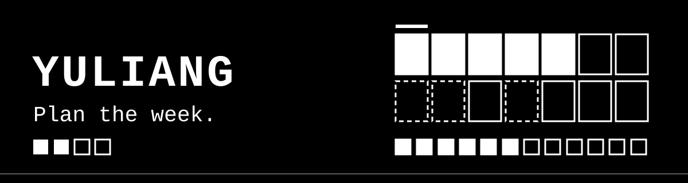
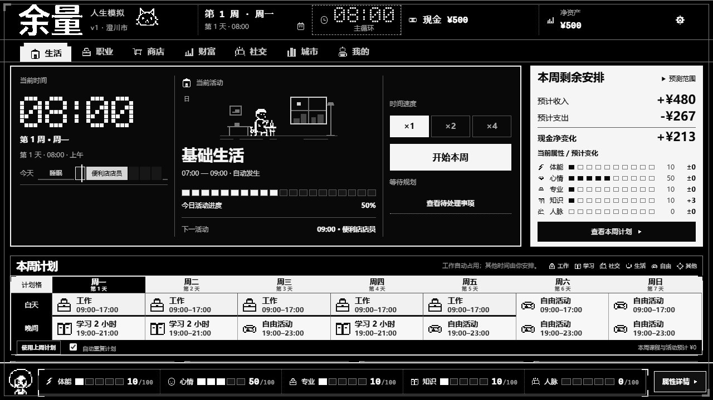
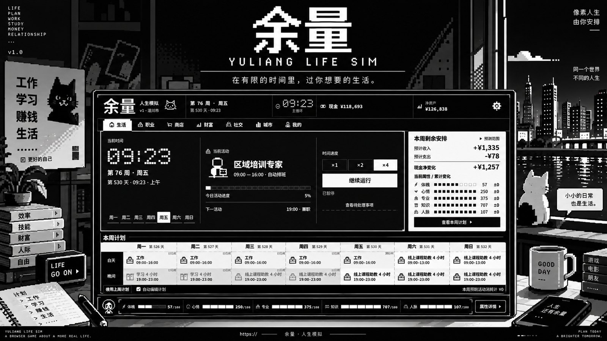

<p align="center">
  
</p>

An open-ended life simulation presented as a black-and-white pixel console. Plan a week, let time run, and decide what matters when life interrupts. There is no prescribed career, fortune, or perfect ending to chase.

**[Play in your browser](https://seiya058904.github.io/yuliang-life-sim/)** · [How it plays](#how-it-plays) · [Systems](#systems) · [Run locally](#run-locally) · [Development](#development)

[](https://github.com/seiya058904/yuliang-life-sim/actions/workflows/deploy-pages.yml)

*Illustration of the weekly planning idea, not a screenshot. The real game is below.* The title is 《余量》, romanized as Yuliang. The game interface is in Chinese; this README is in English.



*The Life screen at the start of a new game in the live web build, captured at 1280×720 from a fresh browser profile.*

## How It Plays

1. **Plan.** Arrange work, study, social, life, and free blocks across the week's grid around the time, money, and opportunities you have.
2. **Advance.** Start the week at ×1, ×2, or ×4 speed and watch work, routines, and expenses play out.
3. **Decide.** When an event, a job offer, or a settlement needs your attention, the simulation stops and hands the choice back to you.
4. **Live with the result.** Review what changed, adjust the plan, and move into the next week.

Browsing the game's pages does not consume simulated time, and time never makes an important choice for you. There is no morality meter: a career path or a financial outcome is a consequence, not a judgment of how well someone lived.

## Systems

The game is organized into seven views, each tied to the same simulation state rather than to a single success score.

- **Life.** The clock, your current activity, time speed, the weekly plan, and attributes such as stamina, mood, expertise, knowledge, and connections.
- **Career.** Jobs, applications, offers, study, and the longer-term effects of career decisions.
- **Shop.** What is worth buying, what it costs, and how owned items affect play through the game's actual rules.
- **Wealth.** Cash flow, invested capital, realized gains, and changing valuations, which the game keeps distinct.
- **Social.** The people in your life, encounters, and how choices carry forward.
- **City.** Places, housing, and everyday choices that shape your options.
- **Profile.** Your character's record.

The interface is hard-edged panels, compact information, and high-contrast states, built to feel like a console for an evolving life rather than a business dashboard. Dates, activities, money, and outcomes all come from the actual simulation state. Keyboard focus, accessible contrast, and reduced-motion behavior are part of the design. It is desktop- and landscape-first, and narrower screens reuse the same core experience.

## Run Locally

Use Node.js and the committed npm lockfile. From the repository root:

```bash
npm ci
npm run dev -- --host 127.0.0.1 --port 4173
```

Open <http://127.0.0.1:4173/>.

> [!NOTE]
> Your progress lives in your browser. The canonical save uses IndexedDB with transaction-based conflict checks and recovery. Clearing site data or switching browsers or origins can leave you without the same saved game, and the local server and the GitHub Pages site do not share a save. Browser storage is local, not a cloud account.

## Development

The game is React, TypeScript, Vite, and Zustand, with the simulation rules kept separate from the interface and the save layer.

```bash
npm run content:validate   # Authored-content contracts
npm run content:simulate   # Deterministic simulation checks
npm test                   # Vitest regression suite
npm run build              # Content validation, TypeScript, Vite build
npm run e2e                # Playwright browser tests
```

Browser tests need a Playwright browser installed. The Pages workflow uses Node.js 22, builds for the `/yuliang-life-sim/` base path, and runs selected desktop browser acceptance checks before deploying.

```text
src/game/engine/       Simulation, time advancement, and rules
src/game/store/        Zustand integration and save/recovery logic
src/game/content/      Authored content, contracts, and validation
src/game/ui/           Life, career, city, shop, wealth, and social views
scripts/               Content checks, simulations, and UI tooling
e2e/                   Browser acceptance scenarios
```

The engine must preserve player-controlled decisions, distinct financial accounting semantics, authored-content contracts, and compatibility with existing saves. Further reading: [product vision](PRODUCT.md), [visual system](DESIGN.md), [repository guidance](AGENTS.md), and the [development notes](docs/).

## Concept Art

Concept art made for this project. It is an illustration, not a screenshot, and details may differ from the shipped interface.



## License

The repository does not include a license file, so no open-source license is granted. Contact the repository owner before redistributing or reusing the code or content.
